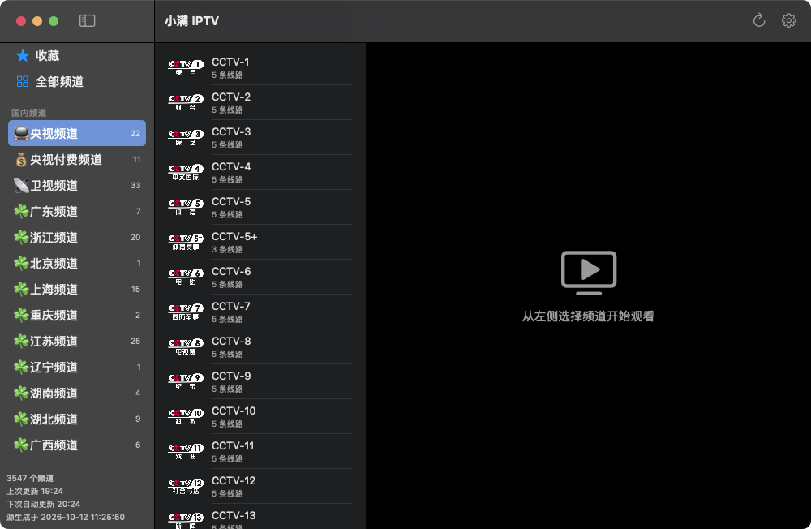

<p align="center"></p>

<h1 align="center">小滿 IPTV</h1>

<p align="center">原生 macOS 看電視、聽電台：國內電視 + 海外電視 + 海外電台，打開就能看。</p>

<p align="center">[简体中文](README.md) · **繁體中文** · [English](README.en.md) · [日本語](README.ja.md) · [한국어](README.ko.md) · [Français](README.fr.md) · [Deutsch](README.de.md) · [Español](README.es.md) · [Русский](README.ru.md)</p>

<p align="center"></p>

## 功能

- **國內電視**：來自 [Guovin/iptv-api](https://github.com/Guovin/iptv-api)（央視、衛視、各省、港澳台、體育、電影等）
- **海外電視**：來自 [iptv-org/iptv](https://github.com/iptv-org/iptv)，依國家分組，可選 17 個國家和地區
- **海外電台**：來自 [Radio Browser](https://www.radio-browser.info)，每個國家最熱門的 80 個
- **頻道列表自動更新**：每小時一次，也可以 ⌘R 手動更新
- **多線路自動切換**：一條線路無法播放時自動換下一條
- **軟體自動更新**：啟動時與每天檢查 GitHub Releases，有新版本一鍵安裝；選單中也能「檢查更新…」
- **9 種介面語言**：简体中文、繁體中文、English、日本語、한국어、Français、Deutsch、Español、Русский
- 分組瀏覽、搜尋、收藏、全螢幕、子母畫面；離線也能看到上次的列表

## 安裝

1. 到 [Releases](https://github.com/minder-z/minder-iptv/releases/latest) 下載 `MinderIPTV-x.y.z.zip`，解壓縮後把 App 拖進「應用程式」。
2. 第一次打開若提示「無法驗證開發者」：在 App 上按右鍵 → 打開。
3. 需要 macOS 14 或更新版本。

## 從原始碼編譯

需要 Xcode 命令列工具（`xcode-select --install`）：

```bash
git clone https://github.com/minder-z/minder-iptv.git
cd minder-iptv
./build_app.sh
```

## 聲明

本應用程式不提供、不儲存任何直播內容，只讀取上述公開專案發布的播放清單。直播來源由第三方收集，版權歸各自所有者，請在當地法律允許的範圍內使用。
